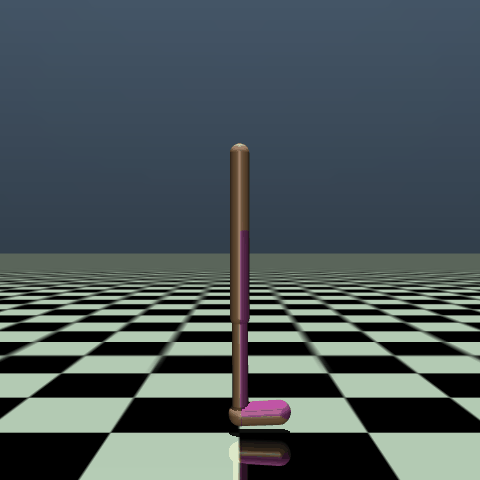

# Walker RL

Teaching a 2D biped (MuJoCo Walker2d) to walk with reinforcement learning.

**Status:** work in progress (week 3 of 8)

## Before and after

| Random policy | PPO, 1M steps |
| --- | --- |
|  |  |

Left: an untrained robot falls in under a second.
Right: after 1 million steps of PPO it moves forward at about 2.4 m/s,
but still falls after a few seconds.

## Setup

    python -m venv .venv
    pip install -r requirements.txt

## Roadmap

- [x] Environment setup, random-policy baseline
- [x] First PPO training
- [ ] Tuned PPO, PPO vs SAC
- [ ] Own experiment

## Results

Mean return over 10 evaluation episodes (deterministic policy).

| Policy | Return | Episode length | Speed |
| --- | --- | --- | --- |
|Random policy | 0.1 +/- 5.2 | 19 steps | - |
| PPO, default settings, 1M steps | 1465.6 +/- 200.4 | 446 steps | 2.29 m/s |