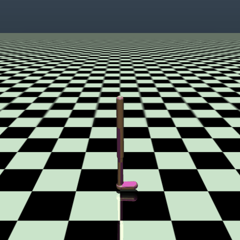
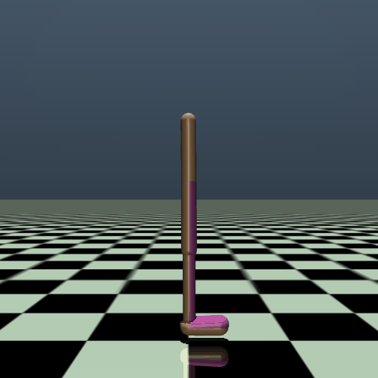
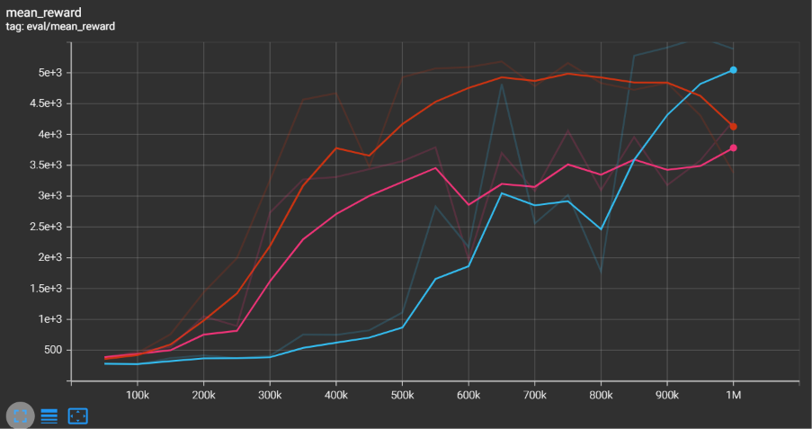

# Walker RL

Teaching a 2D biped (MuJoCo Walker2d) to walk with reinforcement learning.

**Status:** work in progress (week 4 of 8)

## Before and after

| Random policy | PPO, 1M steps |
| --- | --- |
|  |  |  |

First: an untrained robot falls in under a second.
Second: after 1 million steps of PPO it moves forward at about 2.4 m/s, but still falls after a few seconds.
Third: using PPO and observation/reward normalization, it moves at 4.1 m/s, and rarely falls.

## Setup

    python -m venv .venv
    pip install -r requirements.txt

## Roadmap

- [x] Environment setup, random-policy baseline
- [x] First PPO training
- [x] Tuned PPO
- [ ] PPO vs SAC
- [ ] Own experiment

## Results

Mean return over 10 evaluation episodes (deterministic policy).

| Policy | Return | Episode length | Speed | Falls |
| --- | --- | --- | --- |
| Random policy | 0.1 +/- 5.2 | 19 steps | - | 10/10 |
| PPO, default settings, 1M steps | 1465.6 +/- 200.4 | 446 steps | 2.29 m/s | 10/10 |
| PPO + observation/reward normalization | 4950.0 +/- 991.0 | 960 steps |  4.12 m/s | 1/10 |
| PPO + normalization + 4 parallel envs | 5566.5 +/- 13.3 | 1000 steps | 4.57 m/s | 0/10 |
| PPO + normalization + RL Zoo hyperparameters | 4277.8 +/- 196.8 | 991 steps | 3.30 m/s | 0/10 |

Normalizing observations and rewards was the single most important change:
it tripled the return and eliminated falls. Tuned hyperparameters from RL Zoo
did not beat the defaults in this single-seed run.